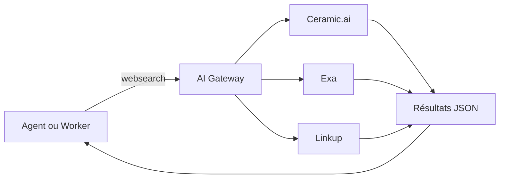
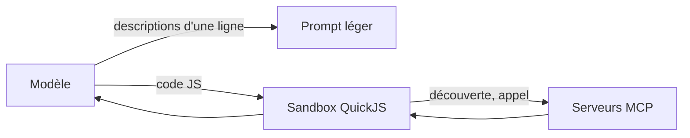
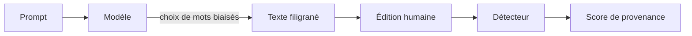

# Tech — Détail du mardi 6 octobre 2026

## 1. Cloudflare Web Search API — un point d'entrée unique pour la recherche web des agents

**Source :** Cloudflare Changelog — https://developers.cloudflare.com/changelog/post/2026-10-02-introducing-web-search-api/
**Date :** 2 octobre 2026

### Contexte

Un agent sans accès au web devine des URLs ou répond avec les connaissances figées de son modèle. Brancher un moteur de recherche oblige à choisir un fournisseur, gérer sa clé, son quota et sa politique de rétention des données. Cloudflare propose de factoriser tout cela derrière une API unique, intégrée à son écosystème Workers et AI Gateway. Le service est en bêta depuis le 2 octobre 2026 et a dépassé 490 points sur Hacker News.

### Comment ça marche

L'API expose la recherche comme une primitive de la plateforme. Tu envoies une requête, tu désignes un fournisseur parmi trois disponibles au lancement (Ceramic.ai, Exa, Linkup), et tu reçois des résultats en JSON. Tous les fournisseurs annoncent le Zero Data Retention et le respect des standards de bots vérifiés.

La facturation passe par les crédits d'AI Gateway, au prix catalogue de chaque fournisseur, sans marge Cloudflare. L'appel peut transiter par une passerelle AI Gateway, via l'option `gateway.id`, ce qui donne un point unique pour la journalisation, la mise en cache et la limitation de débit. Deux modes d'accès existent : l'API REST authentifiée par jeton Bearer, et le binding Worker `env.AI.websearch()`. Les limites de débit ne sont pas précisées dans la documentation : réfère-toi à celles des fournisseurs.



### En pratique — exemple de code

Appel REST tel que documenté (exemple de requête repris de la doc, ajout du `curl`) :

```bash
# Recherche via le fournisseur « ceramic », 5 résultats, via la passerelle par défaut
curl -X POST \
  "https://api.cloudflare.com/client/v4/accounts/$CLOUDFLARE_ACCOUNT_ID/ai/websearch/" \
  -H "Authorization: Bearer $CLOUDFLARE_API_TOKEN" \
  -H "Content-Type: application/json" \
  -d '{
    "query": "What are some fun things to do in Salt Lake City as fall approaches?",
    "provider": "ceramic",
    "limit": 5,
    "options": { "gateway": { "id": "default" } }
  }'
```

Depuis un Worker, le même appel passe par `env.AI.websearch()` sans gérer de jeton.

### Pourquoi ça compte pour toi

Si tu construis des agents côté backend, tu peux changer de fournisseur de recherche en modifiant un seul champ. La contrepartie est de dépendre d'une bêta : garde une abstraction fine dans ton code pour pouvoir sortir de Cloudflare.

---

## 2. Pi Codemode — sortir les définitions MCP du prompt

**Source :** The New Stack — https://thenewstack.io/pi-agent-mcp-codemode/
**Date :** 5 octobre 2026

### Contexte

Chaque serveur MCP connecté injecte la description de tous ses outils dans le contexte du modèle, avant même la première tâche. Mario Zechner, créateur de l'agent Pi, a mesuré le coût : Chrome DevTools MCP consomme environ 18 000 tokens, soit 9 % d'une fenêtre de 200 000, et Playwright MCP 13 700 tokens pour 21 outils. Plus tu branches de serveurs, moins il reste de place pour le travail utile.

### Comment ça marche

Codemode s'intercale entre le modèle et les outils MCP. Au lieu de présenter chaque outil dans le prompt, il ne donne au modèle qu'une description d'une ligne par serveur. Le modèle écrit ensuite du code qui découvre et appelle les outils à la demande.

Ce code s'exécute dans un bac à sable QuickJS volontairement restreint : pas d'API Node, pas de système de fichiers, pas de réseau, pas de timers. Le modèle ne peut donc agir que via les outils exposés.

Un budget de 3 000 tokens par défaut est alloué aux déclarations d'outils exposés directement. Un outil qui dépasse ce budget reste découvrable mais n'est pas déclaré dans le prompt. Le paramètre `toolExposure` règle le détail serveur par serveur et outil par outil : exposer certains outils, laisser les autres derrière la découverte, ou bloquer des opérations sensibles. Dans l'exemple du billet pour GitHub, `search_code` est exposé, les `get_*` restent derrière Codemode et les `delete_*` sont bloqués. Pi 1.0 a aussi réduit le surcoût en raccourcissant les descriptions et en supprimant les déclarations en double, de 5 300 à 3 300 tokens de prompt pour les requêtes GPT-5.6.



### En pratique — exemple de code

La syntaxe exacte de la configuration n'est pas détaillée dans l'article ; ce schéma est une illustration de l'intention, à vérifier dans la documentation de Pi.

```json
{
  "mcpServers": {
    "github": {
      "toolExposure": {
        "search_code": "expose",
        "get_*": "codemode",
        "delete_*": "block"
      }
    }
  }
}
```

### Pourquoi ça compte pour toi

Si tes agents s'appuient sur plusieurs serveurs MCP, mesure d'abord le nombre de tokens consommés à vide. Le blocage par motif des opérations destructrices est aussi un garde-fou simple à copier, même sans Pi.

---

## 3. OpenAI TextGrain — un filigrane statistique pour le texte, désactivé par défaut

**Source :** The New Stack — https://thenewstack.io/openai-api-text-watermarking/
**Date :** 5 octobre 2026

### Contexte

Savoir si un texte vient d'un modèle devient un enjeu de provenance : éducation, modération, conformité. OpenAI introduit TextGrain dans son API. L'article le compare à Anthropic, qui applique un filigrane au niveau du modèle pour tous les produits Claude. Chez OpenAI, l'activation est optionnelle côté API.

### Comment ça marche

TextGrain influence subtilement les choix de mots pendant la génération. Quand plusieurs mots conviennent à un contexte, le modèle favorise certaines options, ce qui laisse un motif statistique que le système d'OpenAI sait détecter. Il n'y a pas de marque visible, et aucune modification par requête n'est nécessaire : l'activation se règle au niveau du projet ou de l'organisation. En Europe, le filigrane serait appliqué automatiquement pour ChatGPT et Codex.

La fiabilité dépend de la longueur et du domaine. Environ 80 % de détection à 200 tokens, environ 95 % à 400. Les mathématiques donnent de moins bons résultats que la prose générale ou la psychologie. Le code est le plus difficile, car il offre moins de choix plausibles à chaque pas.

L'édition fait chuter le signal : avec 10 % de mots remplacés, la détection passe de 92 % à 66 % ; à 25 %, elle tombe à 17 %. L'accès à la détection est limité, pour l'instant, à des organisations de recherche approuvées.



### En pratique — exemple de code

Aucun changement de code n'est requis côté appelant : le réglage est global. Le seul extrait utile est un rappel de la logique de décision à implémenter chez toi.

```python
# Illustration : un score de détection n'est qu'un indice, jamais une preuve
def interpret(detection_rate: float, tokens: int, edited_ratio: float) -> str:
    if tokens < 200 or edited_ratio >= 0.25:
        return "non concluant"   # signal trop court ou trop édité
    return "probable" if detection_rate >= 0.9 else "incertain"
```

### Pourquoi ça compte pour toi

Si ton produit doit prouver l'origine d'un contenu généré, ne compte pas sur ce filigrane seul : quelques mots remplacés suffisent à le casser. Vérifie aussi que l'activation par projet ne s'applique pas par surprise à tes pipelines de génération de code.

### Limites

Le filigrane est probabiliste, et l'accès au détecteur est restreint pour le moment.
