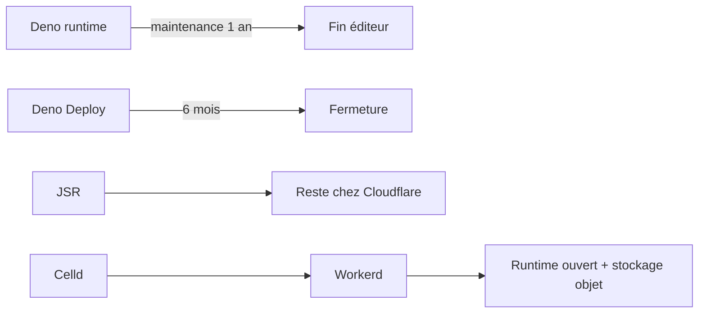
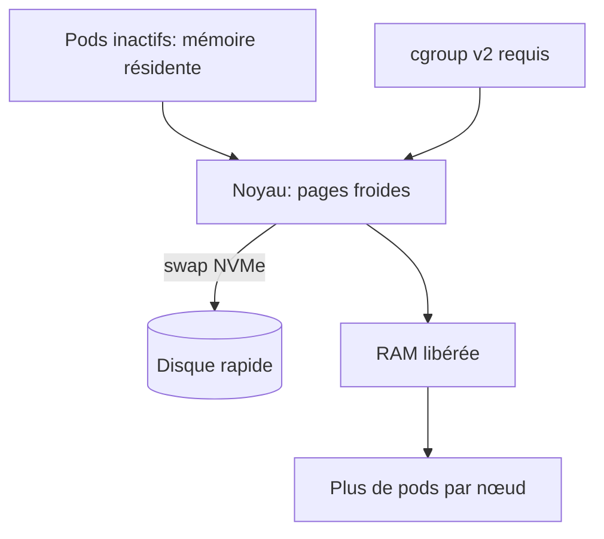

# Tech — Détail du samedi 10 octobre 2026

## 1. Cloudflare rachète Deno — le runtime s'arrête, Celld fusionne dans Workerd

**Source :** The New Stack — https://thenewstack.io/cloudflare-acquires-deno-ryan-dahl/
**Date :** 9 octobre 2026

### Contexte

Deno naît en 2018 de Ryan Dahl, créateur de Node.js, pour corriger les défauts de Node en matière de sécurité et de gestion des dépendances. La société a levé environ 26 M$ et lancé Deno Deploy, concurrent direct de Cloudflare Workers. En 2021, Cloudflare avait bloqué par erreur le site et le registre de Deno, en prenant des fichiers TypeScript pour de la vidéo.

En août, Deno publie Celld, un projet open source qui recrée le modèle de programmation Workers et Durable Objects pour l'auto-hébergement, en créditant Kenton Varda et l'équipe Workers. Le 9 octobre, Cloudflare annonce l'acquisition ; les conditions financières ne sont pas divulguées.

### Comment ça marche

Le rachat porte sur l'équipe. Les conséquences techniques sont explicites :

1. Le runtime Deno autonome reçoit des mises à jour de maintenance et de sécurité mensuelles pendant un an, puis s'arrête côté éditeur.
2. Deno Deploy ferme dans six mois, avec aide à la migration pour les clients payants.
3. Le registre JSR continue sous Cloudflare.
4. Le runtime reste sous licence MIT ; Dahl cite le précédent io.js pour un portage communautaire.
5. Celld est fusionné dans Workerd, le runtime open source de Workers. Dahl et Bert Belder pilotent le projet, attendu sous Apache 2.0.

L'ambition affichée : faire tourner une flotte d'instances Workerd avec pour seule dépendance un bucket de stockage objet standard, avec la même API que la plateforme Cloudflare. Varda justifie le rachat par le besoin d'étoffer les services adjacents pour que le runtime ouvert fonctionne hors du réseau Cloudflare.



### En pratique — exemple de code

Si ton code cible déjà l'API Workers, rien ne change. Ce Worker minimal est le contrat que la fusion veut rendre auto-hébergeable.

```ts
// Worker classique (modèle fetch) — l'API que Celld/Workerd veulent rendre portable.
export default {
  async fetch(req: Request, env: Env): Promise<Response> {
    const url = new URL(req.url);
    if (url.pathname === "/health") return new Response("ok");
    return new Response("Hello from the edge", { status: 200 });
  },
};
```

### Pourquoi ça compte pour toi

Si des scripts ou services tournent sur Deno ou Deno Deploy, planifie la sortie : Deploy ferme dans six mois. Le runtime reste MIT, mais sans éditeur derrière, le risque est celui d'un projet orphelin. Le signal de fond : la consolidation des runtimes JS (Bun chez Anthropic, Deno chez Cloudflare).

### Pour aller plus loin

L'article ne mentionne pas Fresh. Termes financiers inconnus.

---

## 2. Kubernetes — node swap en GA et fin de cgroup v1 pour la densité des charges IA

**Source :** Kubernetes Blog — https://kubernetes.io/blog/2026/10/05/scaling-kubernetes-workloads-with-node-swap/
**Date :** 5 octobre 2026

### Contexte

La mémoire est souvent la première limite dure d'un cluster. Les agents IA aggravent le problème : ils exigent beaucoup de mémoire au démarrage et pour exécuter du code non fiable, puis restent inactifs tout en gardant cette mémoire résidente. Le support du swap sur les nœuds est en disponibilité générale depuis Kubernetes v1.34.

En parallèle, selon un article sponsorisé de The New Stack du 9 octobre (https://thenewstack.io/kubernetes-node-swap-ai/), le kubelet refuse de démarrer sur un nœud cgroup v1 par défaut depuis la v1.35. Le titre dit « dead », mais le corps décrit un refus de démarrage par défaut, pas une suppression pure.

### Comment ça marche

L'idée du swap NVMe : le noyau écrit sur disque rapide les pages mémoire dormantes, ce qui libère de la RAM pour placer davantage de pods. Les auteurs décrivent le swap comme un « amortisseur » de pics de trafic. Trois charges sont testées : compilation de noyaux en CI/CD, navigateurs headless en sandbox et runtimes Python isolés. Le gain annoncé atteint 3× de densité, souvent sans coût de latence notable, avec swap sur SSD NVMe.

Le fonctionnement fin (modes, formule de limite par pod) n'a pas pu être lu dans le billet. Le YAML ci-dessous repose sur ma connaissance générale de la documentation Kubernetes ; vérifie-le avant usage. Pour cgroup v2 : une hiérarchie unifiée et une interface plus cohérente, avec selon la version et la configuration QoS mémoire, gestion OOM consciente des conteneurs et support rootless.



### En pratique — exemple de code

```yaml
# Illustratif — à valider dans la doc officielle de votre version.
apiVersion: kubelet.config.k8s.io/v1beta1
kind: KubeletConfiguration
failSwapOn: false          # autorise le démarrage sur un nœud avec swap
memorySwap:
  swapBehavior: LimitedSwap # limite l'usage du swap par pod (selon la doc générale)
```

```bash
# Vérifier que le nœud est bien en cgroup v2 avant d'upgrader
stat -fc %T /sys/fs/cgroup   # "cgroup2fs" = v2, "tmpfs" = v1
```

### Pourquoi ça compte pour toi

Avant de monter de version, audite tes nœuds : un cgroup v1 bloque le kubelet par défaut depuis la v1.35. Le swap peut réduire ta facture mémoire sur des charges bursty (CI, sandboxes), mais teste la latence sur tes propres workloads : les 3× viennent des benchmarks des auteurs.

### Limites

Le billet de The New Stack est sponsorisé (HPE). Méthodologie de benchmark et matériel détaillés non lus ici.
