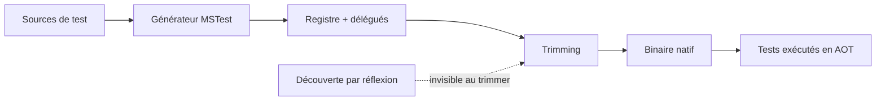
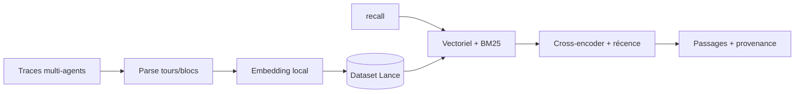

# Rapport hebdo — Semaine W36 (2026-08-31 → 2026-09-06)

Semaine **étroite dans le temps, large dans le fond** : un seul jour de digest (**samedi 6 septembre**), mais **11 sujets** sur **4 catégories actives**, tous datés du 1er au 4 septembre. Deux mouvements de fond la traversent, et ils se répondent. Un : **rendre statique ce qui était dynamique** — MSTest 4.4 remplace la découverte de tests par réflexion par un registre généré à la compilation, KYAML supprime la coercition de types implicite de YAML, NG8109 remonte enfin les alias de signaux, et Hugging Face publie ses kernels WebGPU comme des dépôts à contrat versionné. Deux : **ce que l'outil garantit n'est jamais ce qui reste à ta charge** — Angular Aria te donne les rôles ARIA mais pas le contraste, MSTest rend tes tests exécutables en AOT mais c'est à ton application de fournir son `JsonSerializerContext`, et chiffrer ton DNS ne supprime pas l'observateur, ça le déplace. Côté sécurité, une seule urgence datée : **CVE-2026-85046**, sixième zero-day Chrome de l'année, exploité, échéance CISA au 18 septembre.

## 🏆 Top de la semaine

### 1. CVE-2026-85046 — le V8 vulnérable n'est pas que dans ton navigateur

Confusion de types dans V8, CVSS **8,8**, correctif Google le **3 septembre**, entrée au catalogue KEV de la CISA le **4**, échéance de remédiation fédérale au **18 septembre 2026**. Exploitation confirmée dans la nature avant même le patch.

Comment ça marche, en une phrase : le JIT de V8 **spécule** sur le type d'une variable pour générer du code rapide qui saute les vérifications. Un attaquant qui trouve un chemin où la spéculation reste valide pour l'optimiseur mais fausse à l'exécution obtient une lecture/écriture hors bornes, qu'il escalade en lecture/écriture arbitraire dans le renderer. Point de calibrage important : ça s'arrête **dans le bac à sable**. Prendre l'hôte demande une seconde faille (évasion de sandbox ou élévation de privilèges). Ça ne réduit pas l'urgence — voler sessions, cookies et contenu d'onglets se fait déjà depuis le renderer.

Le vrai sujet de la semaine n'est pas Chrome, qui se met à jour tout seul. C'est **tout ce qui embarque un Chromium que personne ne patche** : Electron interne, WebView2, headless Chrome dans ta CI, images de scraping figées. Une machine de build avec un navigateur headless a souvent accès à des secrets.

```bash
# Cible : >= 152.0.7977.82 (Linux) — .82/.83 sur Windows et macOS
google-chrome --version

# Le point aveugle : les runtimes Chromium embarqués, jamais dans ton plan de patch
find /opt /usr/lib /Applications -name "*.pak" -path "*lectron*" 2>/dev/null
npx electron --version                      # tes propres apps -> rebuild sur un Electron corrigé
docker image ls --format '{{.Repository}}:{{.Tag}}' | grep -Ei 'chrom|puppeteer|playwright'
```

**Source :** SOC Prime — https://socprime.com/blog/cve-2026-85046-analysis/

### 2. MSTest 4.4 — ta CI valide un artefact que tu ne déploies pas

Le billet .NET du 3 septembre pose un constat désagréable : si tu publies en Native AOT ou trimmé, **une suite verte te ment partiellement**. Le cas d'école tient en trois lignes — un test sérialise un `record Receipt(decimal Total)` avec `JsonSerializer.Serialize` et passe en managé, parce que `System.Text.Json` retrouve le type par réflexion. Le même chemin en publication AOT lève `InvalidOperationException: Reflection-based serialization has been disabled for this application`. Le test n'a rien vu parce qu'il ne tournait pas sous le modèle de déploiement livré.

Comment ça marche : c'est un **problème d'ordre d'opérations**. La découverte de tests classique est entièrement dynamique (`Assembly.GetTypes()`, filtrage par attribut, invocation par réflexion) — donc invisible au trimmer, qui supprime tes classes de test. MSTest 4.4 inverse la chronologie : pendant la compilation, donc **avant** le trimming, un générateur de source émet un registre des classes de test, les données d'attributs, les délégués de construction et d'invocation, et les références qui préservent tout ça. Le trimmer voit alors un graphe statique complet. Ton modèle de programmation, lui, ne bouge pas.



Deux responsabilités restent séparées, et c'est tout l'intérêt : le générateur rend le **test** découvrable après trimming ; c'est à ton **application** de fournir ses métadonnées générées. MSTest ne masque pas le problème applicatif, il le fait remonter avant la production.

```xml
<!-- Avant — projet de tests managé classique -->
<Project Sdk="MSTest.Sdk/4.3.0">
  <PropertyGroup><TargetFramework>net10.0</TargetFramework></PropertyGroup>
</Project>

<!-- Après — deux lignes changent, et les tests s'exécutent en natif -->
<Project Sdk="MSTest.Sdk/4.4.0">
  <PropertyGroup>
    <TargetFramework>net10.0</TargetFramework>
    <PublishAot>true</PublishAot>
  </PropertyGroup>
</Project>
```

Action concrète : ajoute **une seule** voie native en CI, sur un projet qui touche sérialisation, DI ou binding de configuration — pas sur des tests arithmétiques. Et fais de la **parité du nombre de tests** un gate : un registre incomplet passe au vert en silence.

**Source :** .NET Blog — https://devblogs.microsoft.com/dotnet/mstest-source-generation/

### 3. `@huggingface/kernels` — 207 kernels WebGPU traités comme des dépendances

Publié le 1er septembre : chaque opération GPU devient un **dépôt versionné sur le Hub**, avec `manifest.json` (le contrat : entrées, sorties, attributs, règles de dérivation de forme), `metadata.json`, `test.json` (correction), `bench.json` (tuning) et des `*.wgsl.jinja` paramétrés.

Comment ça marche : tu demandes un dépôt **et une version de contrat** — distincte d'un opset ONNX ou d'une révision de modèle. Le loader télécharge, dérive la forme et le type de sortie depuis le manifeste, choisit une **variante** adaptée au device (formes égales, broadcast vectorisé, scalaire, broadcast général), génère le shader depuis le template et dispatche. C'est ce choix de variante qui justifie tout l'édifice : le runtime bascule sans que ton code applicatif bouge d'une ligne.

Les chiffres, mesurés sur GPU Apple M4 face à ONNX Runtime Web `1.30.0-dev` : 1 756 cas de test sur 207 opérations, réduits aux **809 comparables**, pour **2,57× en moyenne géométrique** et **1,90× à la médiane** (629 victoires / 176 défaites / 4 nuls). Add à 3,52×, LayerNormalization à 2,22×, Softmax à 2,11× — mais MatMul à **1,14× seulement**, et les mesures excluent chargement, compilation des shaders et readback.

```js
import { getKernel } from "@huggingface/kernels";

// version: 1 = version du CONTRAT du kernel, pas de l'opset ONNX
const add = await getKernel("webgpu-kernels/ai.onnx.Add", { version: 1 });

const { c } = await add({
  a: { data: new Float32Array([1, 2, 3, 4, 5, 6]), shape: [2, 3] },
  b: { data: new Float32Array([10, 20, 30]), shape: [3] }, // broadcast sur dim 0
});
// c a la forme [2, 3] : dérivée du manifeste, pas déclarée par toi.
```

La discipline est celle d'une dépendance NuGet — contrat explicite, version épinglée, tests qui voyagent avec le code. Si tu envisages de l'inférence locale dans une app Angular, ça déplace la question : tu profiles une opération isolée au lieu de subir un runtime monolithique.

**Source :** Hugging Face Blog — https://huggingface.co/blog/webgpu-kernels

## 🅰️ Angular — le compilateur voit plus loin, ton CSS non

Deux sujets, tous deux sur la même frontière : ce que l'outil garantit, et ce qu'il te laisse. Le patch `22.1.5` du **3 septembre** (`fix(compiler-cli): check uninvoked signal aliases in extended diagnostic`, aussi en `22.2.0-next.5`) étend `NG8109` / `interpolatedSignalNotInvoked` : le diagnostic ne s'arrêtait qu'aux références directes typées `Signal<T>`, il remonte désormais la chaîne d'alias jusqu'à la déclaration réelle. Concrètement, du code qui compilait hier échoue aujourd'hui — et **c'est le comportement voulu** : chacune de ces erreurs correspond à une valeur qui ne s'affichait pas à l'écran. Rappel qui coûte cher quand on l'oublie : aucun diagnostic étendu ne s'émet sans `strictTemplates: true`. Sans lui, tu paies l'upgrade sans en toucher le bénéfice.

```ts
// AVANT 22.1.5 — le @let masque le signal, aucun diagnostic n'est émis
@let total = cartTotal;      // alias vers la FONCTION, pas vers sa valeur
// <p>Total : {{ total }}</p>  -> affiche "function () { … }", jamais 42

// APRÈS 22.1.5 — NG8109 remonte l'alias et casse le build
@let total = cartTotal();    // on invoque le signal à l'aliasing
// <p>Total : {{ total }}</p>  -> affiche bien 42
```

Le billet du 2 septembre sur **Angular Aria** teste l'autre bord de la frontière. Repeindre l'exemple d'onglets en néomorphisme — style connu pour ses contrastes faibles — fait tomber le score Lighthouse accessibilité de **100 à 95**, sur un seul critère : le ratio texte/fond. Toute la mécanique clavier et sémantique survit, parce qu'elle appartient au pattern headless (rôles `tablist`/`tab`/`tabpanel`, `aria-selected`, flèches, `Home`/`End`, gestion du focus). Le contraste, lui, ne vit que dans ton CSS — aucune bibliothèque ne peut le garantir, elle ne connaît pas tes couleurs. Le seuil WCAG AA est **4,5:1** pour du texte normal, et le piège le plus insidieux reste le `outline: none` posé pour « nettoyer » le design, qui supprime le seul retour visuel de la navigation clavier que le pattern a soigneusement câblée. Si tu bâtis un design system dessus : un check de contraste automatisé en CI, qui fait échouer le build. Un audit Lighthouse manuel arrive toujours après validation du design.

**Sources :** Angular — https://github.com/angular/angular/releases/tag/v22.1.5 · Angular Blog — https://blog.angular.dev/customizing-angular-aria-tabs-quickly-with-google-antigravity-cli-39ff8e0271a4

## 🔷 .NET — semaine creuse côté release, deux échéances datées

Hors MSTest 4.4 (voir le Top), rien de neuf à tester en urgence : **.NET 11** reste en preview, **Preview 7 du 11 août** demeure la dernière préversion documentée (`break`/`continue` étiquetés en C# 15, pause de circuit Blazor, validation localisée, `SocketsHttpHandler.ShouldEvictConnection`). La **GA est calée sur novembre 2026**, avec un support STS de deux ans (10 novembre 2026 → 9 novembre 2028). Côté écosystème, `FullJoin` d'EF Core 11 se traduit en `FULL OUTER JOIN` depuis la Preview 6 et n'a pas bougé ; Aspire tient une cadence soutenue (13.2 → 13.5), une 13.6 est plausible avant la GA.

Deux dates à mettre dans ton calendrier maintenant. La première est purement opérationnelle et casse des CI sans prévenir : les **clés API NuGet.org** sont plafonnées à **30 jours** de durée de vie, et **toutes les anciennes clés expirent le 1er novembre 2026**. Si un pipeline publie des paquets, la rotation doit déjà être automatisée — pas planifiée pour octobre. La seconde : cale ton passage de `net10.0` à `net11.0` sur la **RC**, pas sur la GA. La RC porte la licence « go-live » et c'est là qu'on découvre les analyseurs qui cassent, avec encore du temps devant soi.

```bash
# Auditer l'échéance NuGet : est-ce qu'une clé longue durée traîne encore dans ta CI ?
grep -rniE 'nuget.*api.?key|NUGET_API_KEY' .github/ azure-pipelines.yml 2>/dev/null

# Le creux de septembre est le bon moment pour solder la dette avant la RC
dotnet list package --outdated --include-transitive
dotnet build -warnaserror -p:AnalysisLevel=latest-all   # les analyseurs qui casseront en net11.0
```

Profite du creux : c'est exactement la fenêtre pour ouvrir le chantier Native AOT décrit dans le Top plutôt que de le découvrir en même temps que la migration `net11.0`.

**Source :** .NET Blog — https://devblogs.microsoft.com/dotnet/mstest-source-generation/

## 🤖 IA — contexte et index deviennent des artefacts

Deux publications du 3 septembre attaquent le même angle mort par deux bouts : ce qui est cher à reconstruire doit devenir un artefact stocké, versionné, portable. **funes** s'attaque au raisonnement perdu. Tes agents produisent déjà le registre qu'on jette : en cherchant dans un dépôt, en essayant, en échouant, en changeant de direction, ils laissent un compte rendu dense de *ce qui a changé* et surtout de *pourquoi*. Mais des traces ne sont qu'une mémoire potentielle — tu ne `grep` pas ta route vers « pourquoi on a abandonné le parseur en streaming » à travers dix mille tours.

Comment ça marche : un RAG classique, bien assemblé, **entièrement local par défaut**. Les traces sont parsées vers une forme tour-et-bloc commune à plusieurs agents, chunkées, embeddées par un modèle local épinglé, écrites dans un dataset **Lance**. À la requête, funes combine recherche vectorielle et BM25, fusionne les classements, reclasse au cross-encoder, repondère par récence et attache les chunks voisins. Rien n'est distillé à l'écriture : un résultat ramène toujours au tour brut qui l'a produit.



```bash
funes add claude                    # indexe l'existant, greffe `recall` et `get` à l'agent
funes add codex acme/funes-memory   # mémoire partagée (dataset HF privé) qui te suit de machine en machine
funes ask claude "what did we decide about the streaming parser"
```

Le chiffre à retenir vient du benchmark handoff-vs-recall, sur deux tâches impossibles à résoudre sans contexte antérieur : le rappel a été le **canal le moins cher — 8× moins qu'un handoff écrit** sur une tâche, 4× sur l'autre. Et la **compaction**, comportement par défaut de la plupart des agents, a échoué sur l'une des deux : son résumé avait aplati les constats qui comptaient.

**NeoMME** (H Company) attaque l'autre coût, celui du stockage d'index. C'est une famille d'encodeurs multimodaux **single-tower** de 260 M et 800 M paramètres, Apache 2.0, entraînés de zéro — sans tour de vision pré-entraînée, sans décodeur causal, dont la recherche n'a de toute façon pas besoin. Un seul Transformer bidirectionnel avale les patches d'image 32×32 et les tokens texte, jusqu'à 16 384 tokens de contexte. Le pré-entraînement est la partie instructive : un **débruitage par diffusion discrète masquée** où le taux de corruption des exemples multimodaux est tiré entre 0,3 et 1. L'intuition est redoutable — avec un masquage léger, « chat » complète très bien « Le [MASK] est assis sur le tapis » sans regarder l'image ; en forçant le masquage, on supprime le raccourci linguistique et on oblige le modèle à lire les preuves visuelles. Résultat sur ViDoRe v3 : **0,523 nDCG@10 pour le 260 M**, meilleur score sous 800 M et à 0,002 de ColQwen2.5 qui pèse 3,75 Md, ~51 pages/s sur une L40S.

Le tableau qui rend la chose exploitable chez toi est celui de la compression de l'index :

| Stratégie | Poids / page | Qualité conservée |
|---|---|---|
| Brut (2048×2048, float32) | ~1,5 Mo | référence |
| Pooling ×10 + int8 partout | 39 ko | > 99 % du nDCG@10 |
| Pooling ×8 + documents binaires | **6 ko** (255× plus petit) | > 95 % |

À 6 ko par page, un index late-interaction devient viable dans Postgres avec `pgvector` ou dans Qdrant sans budget délirant — et la voie page-image supprime tout ton pipeline OCR et ses erreurs silencieuses sur les tableaux.

**Sources :** Hugging Face Blog — https://huggingface.co/blog/funes · Hugging Face Blog — https://huggingface.co/blog/Hcompany/neomme

## 📡 Tech — l'explicite gagne, le chiffrement déplace

Hors CVE (voir le Top), deux sujets structurants. **KYAML** est passé bêta et activé par défaut en Kubernetes **v1.35**, après une alpha en v1.34. Ce n'est pas un nouveau langage de configuration : c'est un **sous-ensemble strict de YAML**, donc tes parseurs et ton outillage existants continuent de le traiter tel quel. L'approche est de réduire le nombre de choix syntaxiques — objets en `{}`, tableaux en `[]`, chaînes entre guillemets doubles — et le gain principal est l'élimination de la **coercition de types implicite**, le piège historique de YAML.

```yaml
# AVANT — YAML conventionnel : trois pièges de typage implicite
data:
  featureEnabled: no        # -> booléen false, pas la chaîne "no"
  version: 1.30             # -> flottant 1.3, le zéro final disparaît
  logLevel: on              # -> booléen true

# APRÈS — KYAML : types explicites, et toujours du YAML valide
data: {
  featureEnabled: "no",
  version: "1.30",
  logLevel: "on",
}
```

Migration à coût nul : `kubectl get … -o kyaml` produit la sortie, `yamlfmt` convertit l'existant, et un `kubectl` plus ancien consomme le résultat sans broncher. Le timing n'est pas anodin et rejoint le fil rouge de la semaine — les manifests sont de plus en plus **générés** (Helm, GitOps, agents de codage) plutôt qu'écrits. Un humain repère une indentation douteuse en relisant dix lignes ; un système qui génère des centaines de ressources n'a pas ce jugement contextuel. Adopte-le d'abord sur les manifests générés, là où personne ne relit ligne à ligne. Limite à garder en tête : KYAML fige la **représentation**, il ne valide pas ta configuration — un manifest parfaitement formé peut toujours référencer une image inexistante.

**Mullvad** ferme ses serveurs DNS chiffrés publics le **2 novembre 2026**, après quatre ans d'exploitation, et finance la fondation Quad9 à la place plutôt que de maintenir un service concurrent. L'intérêt du sujet est moins l'annonce que le rappel technique qu'elle force : le DNS classique voyage en clair sur le port 53, donc ton FAI voit chaque nom que tu résous même quand la connexion suivante est en HTTPS. DoH enveloppe la requête dans une session TLS — l'intermédiaire réseau ne lit plus rien, mais **le résolveur choisi, lui, voit tout**. Chiffrer ne supprime pas l'observateur : ça le déplace, de ton FAI vers l'opérateur du résolveur. Tout le débat porte donc sur sa politique de journalisation et sa gouvernance. Pour les abonnés VPN la bascule est automatique ; l'action concrète est de chercher une adresse Mullvad câblée en dur dans un `resolv.conf`, un Pi-hole, un routeur ou un profil DoH de navigateur. Le 2 novembre, une résolution qui échoue se manifeste comme une panne réseau diffuse, pas comme une erreur DNS lisible.

**Sources :** InfoQ — https://www.infoq.com/news/2026/09/kubernetes-kyaml-manifests/ · Mullvad VPN — https://mullvad.net/en/blog/2026/9/3/shutting-down-our-public-encrypted-dns-servers-and-sponsoring-quad9-instead

## À retenir si tu n'as qu'une minute

- **CVE-2026-85046 (V8, CVSS 8,8, exploitée)** : échéance KEV au **18 septembre**. Chrome se patche seul — inventorie tes **Electron, WebView2 et headless en CI**, cible `152.0.7977.82`.
- **Trois échéances datées** à poser au calendrier : 18 septembre (KEV), **1er novembre** (expiration de toutes les anciennes clés NuGet.org), **2 novembre** (coupure des DNS publics Mullvad).
- **MSTest 4.4 + `PublishAot`** : si tu livres du trimmé ou de l'AOT, ta CI valide un artefact que tu ne déploies pas. Une voie native, sur un projet qui touche sérialisation ou DI, avec la **parité du nombre de tests** en gate.
- **Angular 22.1.5** : NG8109 remonte les alias de signaux → nouveaux builds rouges attendus, ce sont de vrais bugs d'affichage. Inutile si `strictTemplates` n'est pas actif.
- **NeoMME** : un index late-interaction page-image à **6 ko/page** (255× plus petit, > 95 % de la qualité) rend `pgvector` viable pour de la recherche de PDF sans pipeline OCR.

## Index de la semaine

- **Angular** : NG8109 suit désormais les alias de signaux ; Angular Aria garantit la sémantique, pas ton contraste — 2 sujets sur la semaine
- **CSharp** : MSTest 4.4 exécute les tests en Native AOT ; .NET 11 en attente de RC et deux échéances de novembre — 3 sujets sur la semaine
- **IA** : kernels WebGPU versionnés (2,57×), mémoire d'agents locale avec funes, encodeur NeoMME à 6 ko/page — 3 sujets sur la semaine
- **Tech** : zero-day V8 exploité au KEV, KYAML bêta par défaut en v1.35, Mullvad ferme ses DNS publics — 3 sujets sur la semaine

---
*Généré le 2026-09-07 par la routine `weekly` (Claude Cowork). Couvre 2026-08-31 → 2026-09-06. Semaine à une seule journée de digest (samedi 6 septembre) : les sources primaires sont datées du 1er au 4 septembre.*
