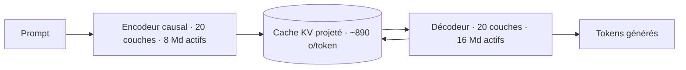
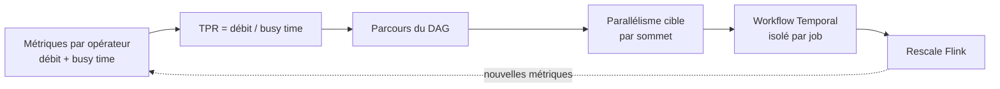

# Rapport hebdo — Semaine W37 (2026-09-07 → 2026-09-13)

Semaine dense : **35 sujets** sur **4 catégories actives**, réparties sur quatre jours de digest (lundi 7, mardi 8, samedi 12, dimanche 13 — creux du 9 au 11). Trois mouvements de fond la traversent. Un : **l'identité ne se déduit ni d'une origine ni d'un échec** — la chaîne SonicWall, la première faille MCP entrée au KEV et le modèle Beyond Zero de Google racontent la même erreur à trois échelles différentes. Deux : **le coût de l'inférence se déplace vers l'asymétrie lecture/écriture** — DeepSeek scinde son modèle en encodeur et décodeur, GLM alterne attention creuse et linéaire, LinkedIn traite ses professeurs comme un service à scaler. Trois : **la chaîne d'approvisionnement déborde du code** — NVIDIA rachète Hugging Face, vlt coupe `install` de `build`, Packer signe enfin tes images machine, et une licence `cc-by-nc-4.0` s'invite dans des poids qu'on croyait ouverts. En toile de fond, une **RC1 .NET 11 avec licence go-live** qui avance ta fenêtre de migration de deux mois.

## 🏆 Top de la semaine

### 1. L'identité fabriquée — de SonicWall à la première faille MCP au KEV

Deux CVE exploitées, un seul patron de bug. **CVE-2026-83548 / 83549** (SonicWall SMA1000, SSRF pré-auth à **CVSS 10,0** chaînée à une injection de commandes post-auth) fonctionne parce que l'endpoint d'administration vérifie *d'où vient* l'appel au lieu de *qui* appelle : une requête émise par l'appliance elle-même est traitée comme légitime, et la SSRF fabrique exactement cette origine. **CVE-2026-59822** (LiteLLM < 1.84.0, **CVSS 8,8**, plus de **80 600 surfaces exposées** relevées par FOFA) fait pire : quand la validation de la clé échoue, le code bascule sur le repli OAuth2 et **fabrique un contexte d'identité vide** pour continuer. N'importe quelle chaîne dans le header suffit — c'est son invalidité même qui déclenche le repli. C'est, à notre connaissance, la première faille spécifiquement **MCP** ajoutée au catalogue KEV de la CISA.

Comment ça marche : dans les deux cas, un signal *contextuel* (l'adresse source, l'absence de jeton valide) est promu au rang de *preuve d'identité*. Le contrôle d'authentification n'est pas contourné au sens cryptographique — il est **satisfait**, par une entrée que l'attaquant contrôle. Et derrière un endpoint MCP, un outil n'est pas une lecture, c'est une **capacité** : base, API interne, système de fichiers.

```csharp
// AVANT — deux variantes du même bug, vues cette semaine en production.
// (a) l'origine tient lieu d'identité : toute SSRF ailleurs devient un bypass d'auth
if (ctx.Connection.RemoteIpAddress is { } ip && IPAddress.IsLoopback(ip))
    return AuthorizationResult.Success();

// (b) l'échec d'authentification produit un appelant anonyme au lieu d'un 401
var auth = ValidateApiKey(bearer);
if (auth is null && _oauthPassthrough)
    auth = new UserAPIKeyAuth();          // <-- personne derrière cet objet

// APRÈS — l'origine n'est qu'un signal ; un échec d'auth est un échec, point.
var identity = await _tokenValidator.ValidateAsync(ctx.Request.Headers["X-Svc-Token"]);
if (identity is null || !identity.HasScope("appliance.admin"))
    return AuthorizationResult.Fail();    // jamais de ClaimsPrincipal vide en sortie de catch
```

Actions datées : hotfix SMA1000 en **12.4.3-03526** ou **12.5.0-02952**, `pip install -U 'litellm>=1.84.0'` et sortie de `/mcp` de toute IP publique. Puis l'audit générique : cherche dans tes services les autorisations qui reposent sur `127.0.0.1`, sur un `X-Forwarded-For` ou sur un objet d'identité construit dans un `catch`.

**Sources :** Rapid7 — https://www.rapid7.com/blog/post/etr-critical-sonicwall-sma1000-vulnerabilities-cve-2026-83548-cve-2026-83549-exploited-in-the-wild/ · GitLab Advisory Database — https://advisories.gitlab.com/pypi/litellm/CVE-2026-59822/

### 2. .NET 11 RC1 go-live — et les unions C# 15 qui se sérialisent enfin

La RC1 publiée le 8 septembre porte une **licence go-live** : Microsoft supporte la build en production avant la GA de novembre. C'est la différence entre « tu peux tester » et « tu peux déployer et ouvrir un ticket ». Dans la foulée, **C# 15 stabilise les types union** — la feature quitte le régime expérimental.

L'intérêt réel pour du backend web est la question que la preview laissait ouverte : comment ça se sérialise. Réponse du billet du 10 septembre : System.Text.Json sérialise une union en **dépaquetant le cas actif**, sans enveloppe ni champ `$type`. `new IntOrString(42)` produit `42`. Parfait pour honorer un contrat existant sans discriminateur — typiquement le `maxUnavailable` de Kubernetes, `2` ou `"25%"` — mais en lecture, deux cas qui produisent la même forme JSON deviennent ambigus, et il faut alors un classificateur structurel qui scanne le payload avant désérialisation. La règle de choix tient en une ligne : **contrat imposé sans discriminateur → `union` ; type que tu maîtrises → `closed` + discriminateur inféré**.

```csharp
// AVANT — "int ou pourcentage" modélisé en object : le compilateur ne vérifie rien.
app.MapGet("/max-unavailable/{name}", object (string name)
    => Deployments.GetMaxUnavailable(name));

// APRÈS — C# 15 : le contrat remonte dans la signature, le switch devient exhaustif.
public union IntOrString(int, string);

app.MapGet("/deployments/{name}/max-unavailable",
    IntOrString (string name) => Deployments.GetMaxUnavailable(name));

IntOrString absolue = 2;          // conversion implicite, sans cast
IntOrString relative = "25%";

static string Decrire(IntOrString v) => v switch
{
    int n   => $"{n} pods",
    string p => p,                 // pas d'arm `_ =>` : CS8509 si un cas manque
};
```

Limite dure à connaître avant de concevoir : le support vient **entièrement de STJ**. Les unions marchent dans les corps JSON, `JsonHubProtocol` de SignalR et l'état persisté Blazor — **pas** dans les query strings, route values, en-têtes ni champs de formulaire. Épingle la RC via `global.json` avec `"allowPrerelease": true` plutôt que globalement, et note que sur Windows seul **Visual Studio 2026 Insiders** la supporte.

**Sources :** .NET Blog — https://devblogs.microsoft.com/dotnet/dotnet-11-rc-1/ · .NET Blog — https://devblogs.microsoft.com/dotnet/unions-and-closed-hierarchies-in-aspnetcore/

### 3. DeepSeek-V4.1-Flash — lire coûte moins cher qu'écrire

**552 Md** de paramètres totaux, **1 M** de tokens de contexte, licence **MIT**, entrée à **0,15 $ / M tokens**. Le chiffre qui compte n'est aucun de ceux-là : c'est le seul modèle de cette échelle à utiliser une architecture **Causal Encoder-Decoder**, et elle est taillée pour les agents de code.

Comment ça marche : une inférence se découpe en **prefill** (lecture du prompt, traitée en parallèle) et **decode** (génération token par token, séquentielle). Dans un MoE classique, les deux activent le même nombre de paramètres. Le CED casse la symétrie — les 40 couches sont scindées en un encodeur causal de 20 couches et un décodeur de 20 couches, et le cache clé-valeur du décodeur est **projeté depuis la sortie de l'encodeur** au lieu d'être recalculé. Le prefill ne fait donc tourner que l'encodeur, **8 Md actifs par token**, contre **16 Md** au decode. V4-Flash activait 13 Md pour les deux.



Second effet, mémoire : le cache KV global tombe au **quart** de celui de V4-Flash, soit environ **890 octets par token**, aidé par Compressed Sparse Attention 2 et un cache en FP4. Moins de mémoire par token, c'est plus de contexte qui tient en cache, donc un **taux de hit plus élevé** — et un agent de code renvoie quasiment le même préfixe à chaque tour de boucle. La règle de prompt à retenir, valable quel que soit le modèle : **contexte figé en tête, variations en queue**, et un routage qui renvoie la requête sur le réplica qui détient déjà le préfixe. Calibrage honnête : **54,8 sur Automation-Bench**, un workflow complexe sur deux échoue. V4-Flash est retiré, V4-Pro rerouté dès le **14 septembre**.

**Source :** Baseten — https://www.baseten.co/blog/deepseek-v41-flash-more-efficient-prefill-for-coding-agents/

### 4. NVIDIA rachète Hugging Face — ta chaîne d'approvisionnement modèles

**12 930 300 000 dollars** pour le Hub qui héberge plus de 3 millions de modèles et 500 000 datasets, utilisés par 18 millions de développeurs. Jensen Huang a pris des engagements publics et précis : plateforme ouverte, calcul NVIDIA non requis, support de l'écosystème open weights maintenu. Rien ne change pour ton exécution demain matin. Ce que l'opération change, c'est la **visibilité** d'une dépendance que la plupart des équipes n'ont jamais inventoriée.

Comment ça marche : si ton service télécharge ses poids depuis `huggingface.co` au démarrage d'un pod, alors ta disponibilité, ta reproductibilité et ta conformité dépendent d'un tiers. Un dépôt de modèle **n'est pas immuable** — `main` peut recevoir de nouveaux poids, une licence peut changer, un dépôt peut être retiré. À la question d'audit « quel poids exact tournait le 12 juillet ? », « la dernière version de `main` » n'est pas une réponse.

```bash
# AVANT — le runtime tire depuis le Hub, sur une révision mouvante :
#   chaque démarrage de pod dépend d'un tiers, et rien n'est rejouable.
python -c "from transformers import AutoModel; AutoModel.from_pretrained('LiquidAI/LFM2.5-350M')"

# APRÈS — on fige une révision AU BUILD, on miroite, le runtime ne sort plus.
REV=$(hf api "models/LiquidAI/LFM2.5-350M" | jq -r .sha)      # SHA du commit, pas un tag
hf download LiquidAI/LFM2.5-350M --revision "$REV" --local-dir ./weights
aws s3 sync ./weights "s3://mlops-models/lfm2.5-350m/$REV/"   # miroir que TU contrôles
echo "MODEL_REV=$REV" >> build.env                            # tracé dans l'artefact

# Au runtime : HF_HUB_OFFLINE=1, ou HF_ENDPOINT vers ton miroir — zéro appel sortant.
```

Tu appliques déjà cette discipline à NuGet et npm. Traite les poids pareil : révision figée, miroir interne, contrôle de licence automatisé. Et miroite ce qui tourne en production, pas ce que la R&D essaie — un modèle de 70 Md en bf16 pèse environ **140 Go**.

**Source :** NVIDIA Blog — https://blogs.nvidia.com/blog/nvidia-to-acquire-hugging-face/

## 🅰️ Angular — la chaîne d'outils front passe en natif

Le fil rouge de la semaine côté front n'est aucune feature de framework : c'est la **réécriture de la chaîne d'outils en Rust et en Go**, et elle progresse sur trois fronts simultanés. **Vite 8.3.0** (10 septembre) supprime l'`esbuildPlugin` du dépôt — plus aucun chemin de code ne l'appelait, oxc a fini de remplacer esbuild comme Rolldown a remplacé Rollup. Le mineur ajoute au passage deux hooks qui manquaient depuis toujours, `closeServer` et `closePreviewServer`, seuls appelés lors d'un **redémarrage à chaud** de `vite.config.ts` : si tu maintiens un plugin maison, remplace tes `httpServer.on('close')`. Une option **`tsconfig` top-level** dispense enfin de `vite-tsconfig-paths`. Attention en lisant les notes : le tag `v8.3.0` ne liste que le delta depuis la beta.1, l'essentiel est cumulé depuis la beta.0. Côté **Angular CLI**, quatre releases le 10 septembre (22.1.8 stable, 22.2.0-next.7, backports 21.2.24 et 20.3.37) dont le fil rouge est le **cache SQLite** : récupération automatique après corruption, métadonnées vérifiées avant lecture pour supprimer les read-locks, type-checking découplé du démarrage du build. L'option `splitting` du builder `unit-test`, introduite huit jours plus tôt, est déjà **dépréciée** — Vitest 5 a corrigé la cause racine JSDOM en amont. Enfin, `debounced()` a reçu le 3 septembre le correctif qui **annule les timers périmés** (22.1.5 / 22.2.0-next.5) : sans lui, chaque frappe armait un `setTimeout` supplémentaire au lieu de remplacer le précédent.

Le sujet le plus marquant est **tsgolint v7**, passé stable le 11 septembre. Comment ça marche : un linter traite deux familles de règles. Les syntaxiques, qu'un AST suffit à évaluer. Et les **type-aware** — `no-floating-promises`, `await-thenable`, exhaustivité d'un `switch` sur une union — qui exigent un vrai modèle des types. Historiquement seul `typescript-eslint` savait le faire, en instanciant depuis Node.js un compilateur écrit en TypeScript. tsgolint refuse de réimplémenter un type checker : il **embarque `typescript-go`** et construit de vrais programmes. Oxlint (Rust) fait la partie bon marché et délègue le type-aware au binaire Go, qui exécute 59 règles sur 61 et renvoie des diagnostics fusionnés. Le saut du `0.x` au **v7** est délibéré — la version suit le compilateur embarqué, `v7.0.2000` = **TypeScript 7.0.2**. Mesures annoncées sur `vscode`, `typescript`, `typeorm` et `vuejs/core` : **12 à 18×** le débit d'ESLint. Pour comparaison, Biome, qui synthétise ses propres types, n'attrape qu'environ **75 %** des cas de `noFloatingPromises`.

```bash
# AVANT — un process Node monte le compilateur TypeScript pour chaque run
npx eslint "src/**/*.ts" --max-warnings 0

# APRÈS — Oxlint orchestre, tsgolint fait l'analyse de types en Go
pnpm add -D oxlint oxlint-tsgolint@7
pnpm oxlint --type-aware --debug        # commence par MESURER : timings par règle
pnpm oxlint --type-aware --type-check   # erreurs du compilateur, MÊME programme TS
npx @oxlint/migrate --type-aware        # traduire la config ESLint plutôt que la réécrire
```

Contrainte bloquante : **TypeScript 7.0 minimum**, `baseUrl` et certaines options héritées non supportées. Et n'active pas `--fix` en CI sans relire les diffs — un rapport documente un autofix qui supprimait une assertion de type exigée par `tsc`.

**Sources :** GitHub — https://github.com/vitejs/vite/releases/tag/v8.3.0 · GitHub — https://github.com/angular/angular-cli/releases/tag/v22.2.0-next.7 · InfoQ — https://www.infoq.com/news/2026/09/tsgolint-oxlint-typescript/

## 🔷 .NET — go-live, huit CVE et deux chaînes de patch

Au-delà de la RC1 du Top, la semaine .NET est faite de sujets d'exploitation. **Azure API Management Standard v2** reçoit la redondance de zone, jusque-là réservée à Premium v2 : l'écart tarifaire est de **700 $** contre **2 801 $** par mois, pour un SLA de **99,95 %** contre **99,99 %** — soit ~22 minutes d'indisponibilité mensuelle autorisées contre ~4. Deux règles à intégrer : ton SLO applicatif ne peut pas être plus strict que celui de ta passerelle, et le nombre d'unités doit survivre à la perte d'une zone (dimensionne **N+1**). Surtout, la redondance n'est configurable qu'**à la création** — une instance mono-zone se corrige par migration complète, pas par une case à cocher. Lance `az apim show -g rg-prod -n apim-prod --query "{sku:sku.name, zones:zones}"` sur tes environnements aujourd'hui. **Copilot code review** s'ouvre à tous les clients Azure DevOps sans inscription, mais le modèle de coût mérite d'être lu avant d'activer : les tokens deviennent des crédits GitHub AI qui apparaissent dans Azure Cost Management **48 heures après** la revue, et un budget dépassé **notifie sans rien arrêter**. Une branch policy automatique posée un vendredi tourne tout le week-end avant que le premier euro ne soit visible. Commence en déclenchement manuel, sur un dépôt. **Agent Framework .NET 1.20.0** corrige une annulation qui ne traversait pas les workflows hébergés Foundry : ton API répondait vite au timeout — donc de belles métriques — pendant que la génération continuait à être facturée. Le pattern à retenir est `CancellationTokenSource.CreateLinkedTokenSource`, et la vérification du token **entre chaque chunk** via `.WithCancellation(ct)`. Côté AWS, **Lambda SnapStart couvre désormais les images de conteneur** : tu passes du plafond de 250 Mo en zip à 10 Go sans renoncer au démarrage sub-seconde. Mais tout ce qui vit dans ton état d'init est **gelé puis restauré à l'identique** — connexions PostgreSQL cassées au réveil, et surtout une graine d'aléa capturée dans l'instantané qui produit la **même séquence** dans chaque environnement. D'où les hooks `RegisterBeforeSnapshot` / `RegisterAfterRestore`, ce dernier borné à **10 secondes**.

Le sujet le plus marquant est le **servicing du 8 septembre** : **.NET 10.0.12, 9.0.20 et 8.0.31**, huit CVE corrigées, dont **CVE-2026-69522** qui déborde sur .NET Framework **4.6.2 à 4.8.1**. Comment ça marche — et c'est le point pédagogique : ton application dépend de **deux chaînes d'approvisionnement distinctes**, et l'outil d'audit que tout le monde connaît n'en couvre qu'une. `dotnet list package --vulnerable` compare tes paquets NuGet aux avis publiés. Le **runtime .NET lui-même n'apparaît pas dans cet audit**, et sa façon de se patcher dépend entièrement de ton mode de publication.

```bash
# 1. Ce que tu EXÉCUTES réellement — l'audit NuGet ne répond pas à cette question
dotnet --list-runtimes | grep -E 'Microsoft\.(NETCore|AspNetCore)\.App (8|9|10)\.'

# 2. L'autre chaîne : les paquets, transitifs inclus
dotnet list package --vulnerable --include-transitive

# 3. Framework-dependent : rollForward latestPatch reprend le 8.0.31 tout seul.
#    Self-contained / Native AOT : le runtime voyage DANS ton binaire -> republier.
#    Conteneur avec FROM épinglé par digest : bumper le digest, sinon rien ne bouge.
docker build --no-cache -t monapi:10.0.12 .
```

Ajoute `dotnet --list-runtimes` à ton contrôle mensuel, à côté de l'audit NuGet. Ce sont deux chaînes différentes — et n'oublie pas ton legacy Framework.

**Sources :** .NET Blog — https://devblogs.microsoft.com/dotnet/dotnet-and-dotnet-framework-september-2026-servicing-updates/ · InfoQ — https://www.infoq.com/news/2026/09/apim-standard-v2-zone-redundancy/ · InfoQ — https://www.infoq.com/news/2026/09/lambda-snapstart-container-image/

## 🤖 IA — moins de calcul par token, plus de clauses

Dix sujets, deux dynamiques opposées. Côté **efficacité**, tout converge vers « ne pas activer ce dont on n'a pas besoin ». **GLM-5.3-Flash** (Z.ai, 7 septembre, **MIT**) active **18 Md** de paramètres sur **320 Md** — moins de 6 % — et alterne couches d'attention **creuse** (rappel exact, cache KV) et **linéaire** (état borné, coût constant) : le cache ne croît que sur une fraction des couches, ce qui attaque directement le ratio contexte/coût. Bouton pratique : `reasoning_effort` vaut `max` par défaut, y compris si tu passes une valeur inconnue — mets-le à `low` sur tes chemins interactifs. **MiniCPM5-2B** (OpenBMB, **Apache 2.0**) prend le chemin inverse, un **dense de 2,52 Md** — le bon choix pour l'embarqué, où charger tous les experts d'un MoE pour n'en utiliser qu'une fraction est disqualifiant — avec un corpus dédié à l'usage d'outils (`UltraData-SFT-Agent-2609`). Environ 5 Go de VRAM en bf16, sous 2 Go en 4 bits. **LinkedIn** documente sa distillation multi-professeurs : deux professeurs spécialisés (oracle de pertinence 8 Md, engagement 1,7 Md) pour un élève de **0,6 Md**, avec les professeurs servis **par SGLang dans la boucle d'entraînement** plutôt que chargés comme des modules PyTorch — **3×** plus rapide, NDCG@10 de **0,7583 à 0,9432**. Résultat négatif à retenir : n'active pas FP8 sous 8 Md, l'overhead de cast mange le gain. Dans la même veine « petit et spécialisé », **GRPO sur LFM2.5-350M** fait passer la conformité IFStruct de **22,6 % à 29,7 %** en 100 pas sur un GPU 16 Go gratuit — la recette tient entièrement dans trois fonctions de récompense déterministes, pondérées `[1.0, 0.5, 2.0]`. Côté outillage, **NVIDIA PAIR** (Apache 2.0, bêta) route l'inférence entre machines appairées en mTLS : ce **n'est pas un moteur** et il ne met pas la VRAM en pool — ajouter des machines augmente le nombre de requêtes simultanées, ça n'accélère pas une requête. Le matching de tag est **exact**, un `502` local signifie « aucun nœud ne détient ce modèle » : traite-le à part dans tes retries. **Granite PatchTST-FM-r2** (IBM, 385 M, Apache 2.0 / OpenMDW) remplace « un modèle par métrique » par un artefact unique en zero-shot, avec 99 quantiles natifs — mais son code ne sera pas maintenu, budgète le fork. Et **Google Mantis** formalise le pattern qui sauve tout harnais agentique : une détection est une **hypothèse**, pas un résultat, et le critère d'acceptation doit être le passage d'un **vérificateur mécanique**, jamais la confiance du modèle.

Le sujet le plus marquant est ailleurs, et c'est une clause juridique. **Cohere North Small Translate 1.0** (10 septembre, 218 Md totaux / 25 Md actifs, 50+ langues, **83,60** sur WMT26) publie ses poids FP8 sous **CC BY-NC 4.0**. « Poids ouverts » signifie uniquement que le fichier est téléchargeable : **ce n'est pas de l'open source**. La clause NC interdit tout usage « principalement destiné à un avantage commercial » — traduire la doc de ton produit, localiser une interface facturée, alimenter un support payant tombent raisonnablement dedans. Le prototype interne est couvert, la production facturée ne l'est pas ; seul Model Vault, sous licence séparée, l'autorise.

```python
# Contrôle de licence à câbler dans ton pipeline d'ingestion de modèles,
# au même titre que ton audit NuGet. À faire AVANT de télécharger 218 Md de poids.
from huggingface_hub import HfApi

info = HfApi().model_info("CohereLabs/North-Small-Translate-1.0")
licence = info.cardData.get("license")          # -> 'cc-by-nc-4.0'

BLOQUANTES = {"cc-by-nc-4.0", "cc-by-nc-sa-4.0", "creativeml-openrail-m"}
if licence in BLOQUANTES:
    raise SystemExit(f"Usage commercial interdit ({licence}) : licence dédiée requise.")
```

Retiens aussi de ce modèle le patron **multi-passes agentique** — traduire, relire la sortie face à la source, corriger — qui vaut **+0,76 point** (83,60 → 84,36) pour au moins un doublement des tokens. Générer, critiquer, corriger : réutilisable partout, à condition de mesurer chez toi si le gain paie.

**Sources :** The New Stack — https://thenewstack.io/cohere-translation-commercial-licensing/ · Hugging Face — https://huggingface.co/zai-org/GLM-5.3-Flash · InfoQ — https://www.infoq.com/news/2026/09/linkedin-ai-multi-teacher/

## 📡 Tech — scaler sur la capacité réelle, pas sur le débit

**Kubernetes v1.37 « Garhwal »** (67 enhancements, et un record de **118 PR d'API review**) apporte deux graduations utiles. Le **scale-to-zero du HPA** passe en bêta activé par défaut : `minReplicas: 0` devient valide, mais **uniquement pour des métriques `object` ou `external`** — un Deployment à zéro pod ne produit aucune métrique CPU, donc rien ne pourrait jamais le réveiller. Si tu avais installé KEDA juste pour descendre à zéro sur une file SQS ou un lag Kafka, tu peux probablement le retirer. En parallèle, **etcd RangeStream** et le décodage concurrent des watch réduisent de **plus de 50 %** le temps d'initialisation du cache sur les bancs à 150 000 pods. Piège à auditer avant l'upgrade : `SELinuxMount` stable par défaut peut faire **échouer le montage** de volumes partagés entre pods aux labels différents. **Netflix Conductor 4.0** (200 000 définitions, 420 M d'exécutions/mois) livre deux patterns à voler tels quels : ne jamais charger l'état complet d'un agrégat pour une décision incrémentale (blueprint léger + chargement paresseux → de ~2 500 à **30 000 tâches** par workflow, p99 d'évaluation **-40 %**), et remplacer le verrou par **deux partitions réconciliées** quand un état est monotone — pending et terminal stockés séparément, terminal prioritaire, échecs d'acquisition de lock tombés de ~2 700 par intervalle à zéro. Directement transposable à tes machines à états PostgreSQL. Côté sécurité applicative, **Google Beyond Zero** prolonge le Top #1 : BeyondCorp décidait au grain de l'**application**, ce qui est acceptable pour un humain borné par sa vitesse de lecture, mais autoriser un agent à « accéder au CRM » revient à l'autoriser à lire 400 000 fiches en trois minutes. La décision descend donc au grain **ressource + action**, complétée de signaux dynamiques de volume et de séquence. Tu n'as pas besoin d'un moteur piloté par IA pour capter 80 % du risque : donne une **identité propre** à chaque agent et pose un quota par identité et par ressource. Trois autres sujets à connaître : l'**ASCII smuggling** (bloc Unicode Tags `U+E0000`–`U+E007F`) est passé du prompt injection à l'évasion de filtres anti-phishing, avec un pic à **2,3 millions de messages** — la règle est **normalise puis compare, jamais l'inverse**, en préservant les séquences de drapeaux gallois/écossais qui utilisent légitimement ces code points ; le **keepalive NAT-T offloadé** d'Android contourne le lockdown VPN parce que les paquets naissent dans le chip réseau, **en dessous** du point de contrôle applicatif (aucune permission requise, aucun CVE, aucun correctif — l'enforcement doit remonter au niveau réseau) ; et **`google.com/goto`** casse le parsing de SERP en remplaçant chaque `href` par un blob protobuf **chiffré avec Tink** — pas encodé, chiffré : la clé est chez Google, la seule voie restante est de suivre la redirection. Enfin, **Packer 1.16** apporte la provenance **SLSA v1** au niveau de l'image machine (in-toto, signature Fulcio sans clé, journal Rekor) : transforme-la en gate de déploiement, une image sans attestation valide ne part pas.

Le sujet le plus marquant est l'**autoscaler Flink** que Netflix adopte pour plus de **30 000 jobs**, avec une équipe qui rapporte **58 %** de baisse de dépense de calcul annualisée — environ **1,1 M$ par an**. Comment ça marche : l'ancien système raisonnait au niveau **cluster**, donc tous les opérateurs d'un job partageaient la même décision — structurellement faux dès qu'un opérateur de parsing sature pendant qu'une jointure s'ennuie. La bascule repose sur le **True Processing Rate** (DS2, FLIP-271). Le débit observé seul ne dit rien : un opérateur à 1 000 enr/s peut être saturé ou simplement sous-alimenté. Flink expose aussi le **busy time**, la fraction de temps où l'opérateur travaille vraiment. D'où `TPR = débit observé / busy time` — 1 000 enr/s à 20 % d'occupation, c'est une capacité réelle de 5 000. L'autoscaler parcourt ensuite le DAG et calcule, par sommet, `débit entrant attendu / (TPR × cible d'utilisation)`.



```yaml
# La cible d'utilisation est le réglage qui compte. 0.7 est le défaut communautaire ;
# Netflix descend à 0.45 : plus de marge, donc moins de rescales sur les jobs à état lourd.
job.autoscaler.enabled: "true"
job.autoscaler.stabilization.interval: "5m"
job.autoscaler.metrics.window: "10m"
job.autoscaler.target.utilization: "0.45"
job.autoscaler.scale-down.max-factor: "0.6"   # freiner la descente plus que la montée
```

Le principe dépasse Flink. Chaque fois que tu autoscales sur du débit brut — pods ASP.NET Core, workers de file, consumers Kafka — tu confonds « ce que le composant traite » et « ce qu'il pourrait traiter ». Diviser par le taux d'occupation corrige le biais. Et quand le redimensionnement coûte cher, surprovisionner bat rescaler souvent.

**Sources :** InfoQ — https://www.infoq.com/news/2026/09/netflix-flink-autoscaler/ · The New Stack — https://thenewstack.io/kubecon-kubernetes-updates-security/ · InfoQ — https://www.infoq.com/news/2026/09/netflix-conductor-4-workflow/

## ⚠️ Fil rouge — les défauts qui changent en silence

Cinq sujets de la semaine partagent une même signature : une valeur par défaut bascule, rien ne lève d'erreur, et le symptôme apparaît des semaines plus tard. Le **CERN** en donne la version extrême — un simple `-march=x86-64-v2` sur les paquets d'une distribution ne rend pas les binaires « plus lents » sur du matériel ancien, il les rend **impossibles à exécuter** : instruction illégale, pas de dégradation progressive, pas de repli. Près des deux tiers du matériel embarqué de contrôle d'accélérateur deviennent inutilisables, estimation **5,4 M CHF**, d'où la migration de **2 200 machines** vers Debian 13. Lance `ld.so --help | grep -A3 'glibc-hwcaps'` sur tes runners de CI, hyperviseurs et VM à CPU conservateur **avant** une montée de version majeure. Les autres cas sont plus discrets : `preloadInitial` passe à `false` par défaut dans le CLI Angular quand un service worker est actif (ton HTML généré change) ; `clear_thinking` vaut `false` chez GLM-5.3-Flash, donc la trace de réflexion s'accumule au fil des tours ; un budget Azure sur Copilot code review **notifie sans arrêter** ; `SELinuxMount` peut casser des montages partagés en v1.37.

Le cas le plus dangereux est **Polars 2.0-rc**, parce qu'il ne casse rien de visible. `collect()` bascule sur le **moteur de streaming** par défaut — « facilement 5× plus rapide », gains mémoire importants — qui exécute la requête **par lots** parallèles. C'est exactement ce qui permet de dépasser la RAM disponible, et exactement ce qui détruit l'ordre : `join`, `group_by` et `unpivot` ne garantissent plus l'ordre des lignes. Le guide de migration l'écrit dans un encadré « danger » — le changement « peut silencieusement impacter les résultats de tes pipelines ». Aucune exception n'est levée : un `.head(10)` après un `group_by` continue de rendre dix lignes, simplement pas les mêmes.

```python
import polars as pl
lf = pl.scan_parquet("commandes.parquet")

# AVANT — Polars 1.x : moteur en mémoire, ordre incident stable en pratique
top = (lf.group_by("client_id")
         .agg(pl.col("montant").sum().alias("total"))
         .head(10)                                   # devient non déterministe en 2.0
         .collect())

# APRÈS — option A (recommandée) : écrire l'intention que le code supposait
top = (lf.group_by("client_id")
         .agg(pl.col("montant").sum().alias("total"))
         .sort("total", descending=True)             # l'ordre devient explicite
         .head(10)
         .collect())

# Option B : maintain_order=True (coût en perf) · Option C, filet le temps de l'audit :
top = lf.group_by("client_id").agg(pl.col("montant").sum()).collect(engine="in-memory")
```

Tout code SQL ou dataframe qui dépend d'un ordre non explicité est un bug en sursis — PostgreSQL te le rappelle déjà sur un `SELECT … LIMIT` sans `ORDER BY`. Profite de la fenêtre RC : cherche tous les `head`, `first`, `slice` et écritures de fichiers qui suivent un `join` ou un `group_by`, et ajoute les `sort` manquants maintenant.

**Sources :** The New Stack — https://thenewstack.io/polars-streaming-row-order/ · InfoQ — https://www.infoq.com/news/2026/09/cern-debian-infra/

## À retenir si tu n'as qu'une minute

- **Deux CVE exploitées, un patron commun** : SonicWall SMA1000 (hotfix **12.4.3-03526** / **12.5.0-02952**) et LiteLLM (**≥ 1.84.0**, première faille MCP au KEV, **80 600** surfaces exposées). Puis audite tes autorisations fondées sur l'origine ou sur un objet d'identité construit dans un `catch`.
- **Servicing .NET du 8 septembre** : **10.0.12 / 9.0.20 / 8.0.31**, huit CVE, dont une qui descend à **.NET Framework 4.6.2**. Ton audit NuGet ne voit pas le runtime — ajoute `dotnet --list-runtimes` au contrôle mensuel, et republie si tu livres en self-contained ou AOT.
- **.NET 11 RC1 est go-live** : tu peux basculer un service non critique dès maintenant, avec support. Épingle via `global.json` + `"allowPrerelease": true`, jamais globalement.
- **Polars 2.0-rc** : streaming par défaut, ordre des lignes non garanti après `join` / `group_by`, **sans erreur**. Ajoute les `sort` manquants pendant la RC.
- **Deux gardes à poser sur tes modèles** : épingle une **révision** (SHA) et miroite les poids au build ; contrôle la licence à l'ingestion — un `cc-by-nc-4.0` en production est une exposition que personne ne verra avant l'audit.

## Index de la semaine

- **Angular** : chaîne d'outils en Rust/Go — Vite 8.3 sort esbuild, tsgolint v7 (12-18×) branche le lint type-aware sur typescript-go, CLI 22.1.8 durcit le cache SQLite — 6 sujets sur la semaine
- **CSharp** : .NET 11 RC1 go-live et unions C# 15 dans STJ, huit CVE de servicing, APIM Standard v2 zone-redundant, SnapStart sur conteneurs — 7 sujets sur la semaine
- **IA** : NVIDIA rachète Hugging Face (12,93 Md$), DeepSeek CED (prefill 8 Md / decode 16 Md), GLM-5.3-Flash MIT, et une licence NC chez Cohere — 10 sujets sur la semaine
- **Tech** : autoscaling sur le True Processing Rate (58 % d'économie), Kubernetes v1.37 scale-to-zero, Conductor 4.0 sans verrou, et trois vecteurs de fuite silencieuse — 12 sujets sur la semaine

---
*Généré le 2026-09-14 par la routine `weekly` (Claude Cowork). Couvre 2026-09-07 → 2026-09-13. Quatre jours de digest disponibles (7, 8, 12 et 13 septembre) ; aucun digest du 9 au 11, les sujets du 12-13 couvrent cette fenêtre.*
