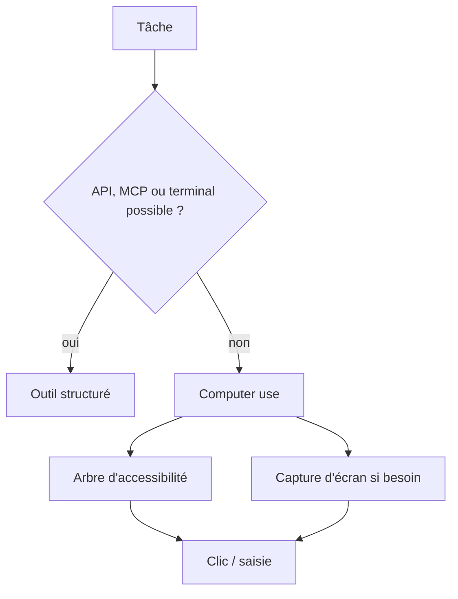
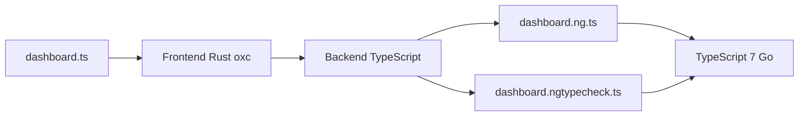
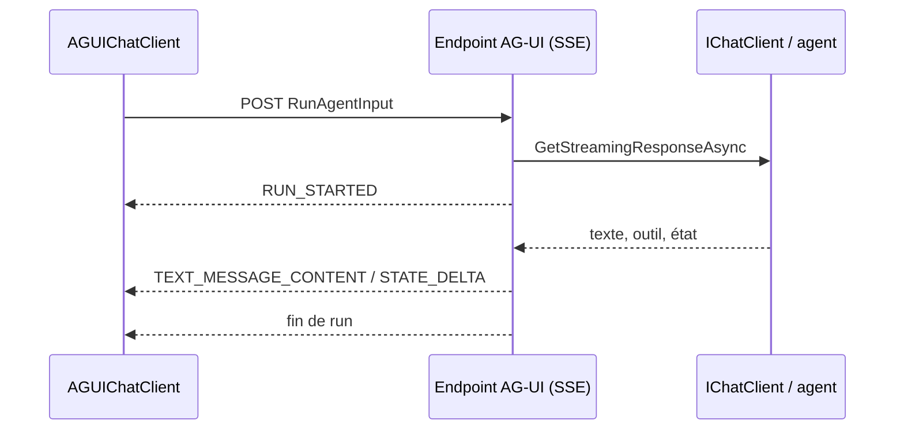

# Rapport hebdo — Semaine W40 (2026-09-28 → 2026-10-04)

Semaine **très mince côté matière** : un seul digest est tombé dans la fenêtre (dimanche 4 octobre), qui regroupe **8 sujets** sur **4 catégories actives** (Angular, CSharp, IA, Tech) ; les jours du 28 septembre au 3 octobre n'ont produit aucun fichier. Les sources, elles, datent de la fin de semaine précédente et de cette semaine (25 septembre → 3 octobre). Trois mouvements de fond se dégagent. Un : **l'agent qui pilote une interface devient un citoyen de première classe** — computer use chez GitHub, modèles ouverts Holo4, protocole AG-UI et composants Blazor. Deux : **on cesse de croire l'agent sur parole** — on juge l'état de la base (ThinkingBox) et on borne la dépense (plafonds durs). Trois : **l'outillage se découple pour tenir la vitesse** — Angular sort son compilateur de l'API TypeScript pour TypeScript 7.

## 🏆 Top de la semaine

### 1. Computer use : de la démo au repli outillé

**GitHub Copilot** lance le computer use en préversion publique (macOS, Windows) et **H Company** publie **Holo4** en poids ouverts (27B dense, 35B-A3B MoE, Holotron4 Nano). Les deux disent la même chose : piloter une application sans API devient banal, mais reste un **dernier recours**. Holo4-27B atteint 61,7 % sur OSWorld 2.0, contre 81,8 % cités pour Opus 5.5 : l'argument est le coût par tâche, pas le score.

Comment ça marche : côté GitHub, le plugin embarque son serveur MCP et lit d'abord l'**arbre d'accessibilité** de l'OS (chaque contrôle = un nœud avec nom, rôle, valeur) ; la capture d'écran n'intervient que si le contexte visuel l'exige. C'est plus fiable que deviner des pixels, sans supprimer les erreurs (timing, interfaces dynamiques, workflows longs).



À faire : réserve ce mode aux applications sans surface programmable, et ferme les données sensibles avant la session (`/permissions show` liste ce que l'agent peut faire).

### 2. Garde-fous : juger l'état, borner la dépense

**ThinkingBox** (Microsoft) pose une règle : *une trajectoire est une affirmation, l'état de la base est la preuve*. Sur 121 680 essais valides avec 12 modèles, **79 853 échouent aux contrôles tout en paraissant réussis**, et environ 67 % de ces échecs ont modifié l'état sans signaler d'erreur. Opus 5.5 mène avec 67,16 % de pass@1 mais ne passe les 20 essais que sur 241 tâches (47,53 %) : la **constance** est le vrai indicateur. En miroir, **Simon Willison** réclame des **plafonds de dépense durs par défaut** : un plafond souple est asynchrone (e-mail après la facture), un plafond dur est synchrone avec l'autorisation et refuse la requête suivante.

Les deux se transposent chez toi sous forme de code à toi (illustration, pas une fonctionnalité d'un fournisseur) :

```csharp
// Garde-fou synchrone : coupe net quand le plafond mensuel est atteint
public sealed class HardBudgetHandler(IBudgetStore store, decimal capEur)
    : DelegatingHandler
{
    protected override async Task<HttpResponseMessage> SendAsync(
        HttpRequestMessage req, CancellationToken ct)
    {
        if (await store.SpentThisMonthAsync(ct) >= capEur)
            return new HttpResponseMessage(HttpStatusCode.PaymentRequired);

        var res = await base.SendAsync(req, ct);
        await store.AddAsync(EstimateCost(res), ct); // comptage de la dépense
        return res;
    }
    static decimal EstimateCost(HttpResponseMessage r) => 0.01m; // à adapter
}
```

À faire : une clé d'API dédiée par agent, un plafond dur côté fournisseur ou dans ton proxy, et des tests d'agent qui vérifient la base fraîche (répétés plusieurs fois) plutôt que le texte renvoyé.

### 3. AG-UI et Blazor : un protocole d'événements agent ↔ interface

Microsoft publie, avec CopilotKit, le **SDK .NET AG-UI** (MIT, cinq paquets NuGet) et des **composants Blazor** expérimentaux (`Microsoft.AspNetCore.Components.AI`, prérelease, SDK .NET 11 RC1). L'idée : au lieu de réinventer un format de flux, le serveur convertit `IChatClient.GetStreamingResponseAsync` en événements typés (`RUN_STARTED`, `TEXT_MESSAGE_CONTENT`, `STATE_DELTA`…) transportés en Server-Sent Events. Côté client, `AGUIChatClient` se présente comme un `IChatClient` ordinaire ; les approbations bloquantes et l'état partagé (JSON Patch, RFC 6902) font partie du protocole.

```csharp
// Serveur : rejoue le flux du modèle ou de l'agent en événements AG-UI
app.MapPost("/", (RunAgentInput input, IChatClient chatClient /* ... */) =>
{
    var context = input.ToChatRequestContext(/* ... */);
    var events = chatClient.GetStreamingResponseAsync(/* ... */)
        .AsAGUIEventStreamAsync(context, cancellationToken);
    return TypedResults.ServerSentEvents(events); // SSE natif ASP.NET Core
});

// Client : un IChatClient qui parle AG-UI, utilisable par un front TS ou Blazor
var chatClient = new AGUIChatClient(new(httpClient, "http://localhost:5001"));
```

À faire : si ton front est Angular, retiens le modèle (blocs typés, approbation bloquante, état par JSON Patch). Le protocole est jeune : vérifie la stabilité des paquets avant la production.

## Angular — ngp, le compilateur découplé de TypeScript

L'équipe Angular annonce **`ngp`** (Angular Preprocessor), un préprocesseur écrit en Rust (`oxc`) qui s'exécute **avant** TypeScript 7 (réécriture native en Go). Raison : `ngtsc` s'accrochait à l'API `ts.Transformer`, en JavaScript, qui disparaît avec un binaire Go. `ngp` émet pour chaque fichier un `*.ng.ts` (décorateurs compilés) et un `*.ngtypecheck.ts` (templates traduits pour le typage), TypeScript 7 compile le résultat sans rien savoir d'Angular. Aucun benchmark Angular n'est publié : le gain de dix fois de TypeScript 7 n'est **pas démontré** sur un build complet.



```typescript
// Entrée (ce que tu écris)
@Component({ selector: 'app-dashboard', template: `<h1>{{ title() }}</h1>` })
export class Dashboard { title = signal('Ventes'); }

// Sortie schématique du préprocesseur (pas la sortie réelle de ngp)
export class Dashboard {
  title = signal('Ventes');
  static ɵcmp = /* définition de composant compilée */ null as any;
}
```

Rien à migrer aujourd'hui ; prévois un essai côté CLI avant la fin de l'année et lis les breaking changes de type-checking.

## CSharp — de l'agent au composant

Deux billets liés : AG-UI côté transport, Blazor AI côté rendu. `UIAgent` enveloppe un `IChatClient`, transforme les `ChatResponseUpdate` en `ContentBlock` observables (texte, appel d'outil, `FunctionApprovalBlock`, action frontend), et `AGUIChatClient` fait le lien avec le serveur. Limites : prérelease, `MessageInput` ne gère que du texte, codec Protobuf partiel.



## IA — Holo4 et ThinkingBox

Holo4 s'entraîne en trois temps : SFT sur 127 milliards de jetons, deux experts RL (~10 000 tâches générées par l'« Agentic Task Factory »), puis fusion en un seul modèle. Les poids existent en BF16, FP8, NVFP4 et GGUF 4 bits ; la licence n'est pas précisée dans le billet, lis chaque fiche avant un usage commercial. ThinkingBox, lui, évalue 507 tâches (477 jugées par contrôles exécutables sur l'état) avec 20 essais sur backend neuf.

```mermaid
flowchart LR
  T[Tâche] --> B[Backend neuf x20]
  B --> A[Agent via MCP]
  A --> S[Effets de bord extraits]
  S --> J[Juge déterministe]
  J --> M[pass@1 / pass@20 / 20 sur 20]
```

## Tech — computer use et plafonds durs

Le fil rouge Tech : l'agent est puissant, donc il faut le cadrer. GitHub documente des permissions explicites (macOS : Accessibilité + Enregistrement d'écran) et une politique d'entreprise via `managed-settings.json` qui l'emporte sur les réglages locaux ; Simon Willison transpose le même réflexe à la facturation. À noter : le billet de Willison est une prise de position, pas une spécification technique.

```bash
# Dans une session Copilot : voir ce que l'agent a le droit de faire
/permissions show
# Approbations temporaires (session) ou permanentes ;
# managed-settings.json (politique d'entreprise) l'emporte sur le local.
```

## À retenir si tu n'as qu'une minute

- **Computer use = repli** : API, MCP ou terminal d'abord ; l'arbre d'accessibilité prime sur les pixels.
- **Mesure la constance** : Opus 5.5 ne réussit 20 essais sur 20 que sur 47,53 % des tâches ThinkingBox — le pass@1 ne suffit pas.
- **Plafond dur** : une clé par agent, refus synchrone au seuil, marge + alerte en amont.
- **AG-UI** : un agent .NET s'expose en SSE via `IChatClient` et se consomme depuis Angular ou Blazor.
- **Angular + TypeScript 7** : `ngp` arrive, aucun benchmark publié — rien à migrer maintenant.

## Index de la semaine

- **Angular** : `ngp`, préprocesseur Rust qui découple Angular de TypeScript 7 — 1 sujet sur la semaine
- **CSharp** : SDK AG-UI .NET et composants Blazor AI (`UIAgent`) — 2 sujets sur la semaine
- **IA** : Holo4 (agents computer use ouverts) et ThinkingBox (évaluation par l'état de la base) — 2 sujets sur la semaine
- **Tech** : Copilot computer use et plafonds de dépense durs — 2 sujets sur la semaine

---
*Généré le 2026-10-05 par la routine `weekly` (Claude Cowork). Couvre 2026-09-28 → 2026-10-04.*
